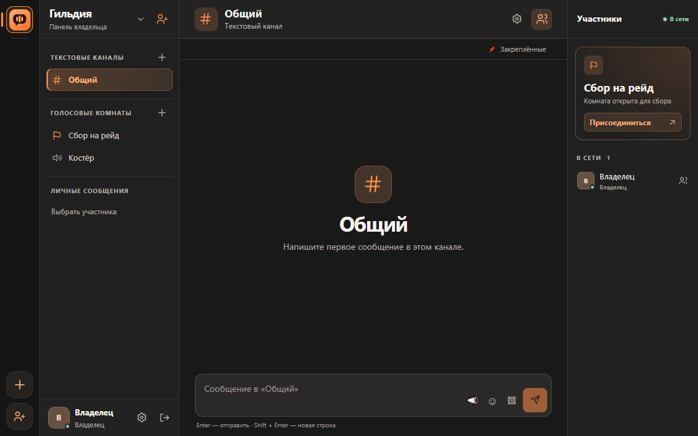

  

# DLMessenger

**Мессенджер для моей гильдии и друзей.**

Личные чаты, голосовые комнаты, звонки и демонстрация экрана — на своём сервере DamageLife.

[🖥️ Windows](https://github.com/VegasGhoul/DLMessenger/releases/tag/v2.3.0) · [📱 Android](https://github.com/VegasGhoul/DLMessenger/releases/tag/mobile-2.3.0) · [Помощь](https://github.com/VegasGhoul/DLMessenger/issues/new)

## 🎄 Новогодний выпуск 2.3.0

**Праздничное оформление — только на ПК.** Выбор темы компьютера не меняет оформление телефона.

- Плавный периодический снег, мерцающие гирлянды и Гринч с тихой подсказкой.
- Дед Мороз с оленями пролетает раз в 2–10 минут; анимации отдыхают при сворачивании.
- Новогодняя скидка 10% на Boost и украшения: Boost — 135 ₽, Boost Plus — 288 ₽ за 30 дней.
- Редкий подарок с шансом 0,1% — личный купон 5% на одно украшение, вместе с акцией до 15%.
- Отдельные карточки Базового, Boost и Boost Plus с понятными различиями.
- Три минуты ожидания личного вызова и официальное сообщение о пропущенном звонке.

Тема бесплатна для всех аккаунтов. Её можно сменить в **Личных настройках → Оформление**. На Android добавлены звонки и тарифы, без снега, Гринча и зимнего оформления.

## Скачать

| Платформа | Версия | Загрузка |
| --- | --- | --- |
| **Windows 10/11 x64** | **2.3.0** | [Скачать установщик](https://github.com/VegasGhoul/DLMessenger/releases/download/v2.3.0/DLMessenger-2.3.0-Setup-x64.exe) |
| **Android 7.0 и новее** | **2.3.0** | [Скачать APK](https://github.com/VegasGhoul/DLMessenger/releases/download/mobile-2.3.0/DLMessenger-2.3.0-Android.apk) |
| **iPhone · iOS 17 и новее** | 2.0.0, неподписанная сборка | [Открыть выпуск iPhone](https://github.com/VegasGhoul/DLMessenger/releases/tag/mobile-2.0.0) |

**Обновление Windows и Android:** установите новый пакет поверх прежней версии, сохранив данные приложения. Проверка обновлений доступна в настройках DLMessenger. Удалять приложение перед обновлением не требуется.

**iPhone:** существующий выпуск 2.0.0 содержит неподписанный IPA и требует подписи перед установкой. Исправленный выпуск 2.3.0 сейчас опубликован для Windows и Android.

В новых выпусках приложен файл `SHA256SUMS.txt` с контрольными суммами. [Все выпуски](https://github.com/VegasGhoul/DLMessenger/releases).

## Что умеет DLMessenger

| | Возможности |
| --- | --- |
| 💬 **Чаты** | Личные сообщения и текстовые каналы, редактирование, закрепления и реакции |
| 🎙️ **Голос** | Комнаты для рейдов и общения, личные звонки, режим рации и настройки микрофона |
| 🖥️ **Экран** | Демонстрация окна или экрана из Windows, выбор качества и просмотр на весь экран |
| 🛡️ **Сообщества** | Свои серверы, приглашения, роли, права доступа и модерация |
| ✨ **DamageLife Boost** | Оформление профиля и имени, украшения и дополнительные возможности |
| 📨 **Поддержка** | Обращения и помощь внутри приложения |

## Как подключиться

1. Установите версию для своей платформы и войдите в аккаунт или зарегистрируйтесь.
2. Приложение подключится к DamageLife автоматически — вводить адрес сервера не нужно.
3. Откройте личные сообщения или вступите в сервер по приглашению. При регистрации добавляется официальный сервер DamageLife.

## О проверках и обратной связи

Новые функции 2.3.0 проверены 215 автоматическими тестами и отдельными проверками интерфейса ПК и телефона. Телефон сохраняет обычное оформление. Фоновая голосовая связь ранее физически проверена на Honor 10X Lite с Android 10 в версии 2.2.5, включая выключение экрана более 71 секунды. Проверка одного устройства не охватывает все модели и сети.

Если что-то работает неправильно, напишите в поддержку приложения или [создайте обращение на GitHub](https://github.com/VegasGhoul/DLMessenger/issues/new). Укажите версию, платформу и шаги воспроизведения — это поможет быстрее найти причину.
