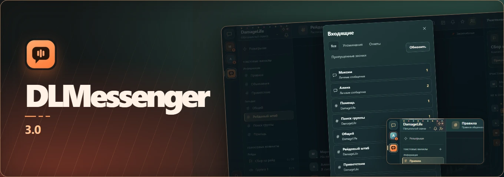
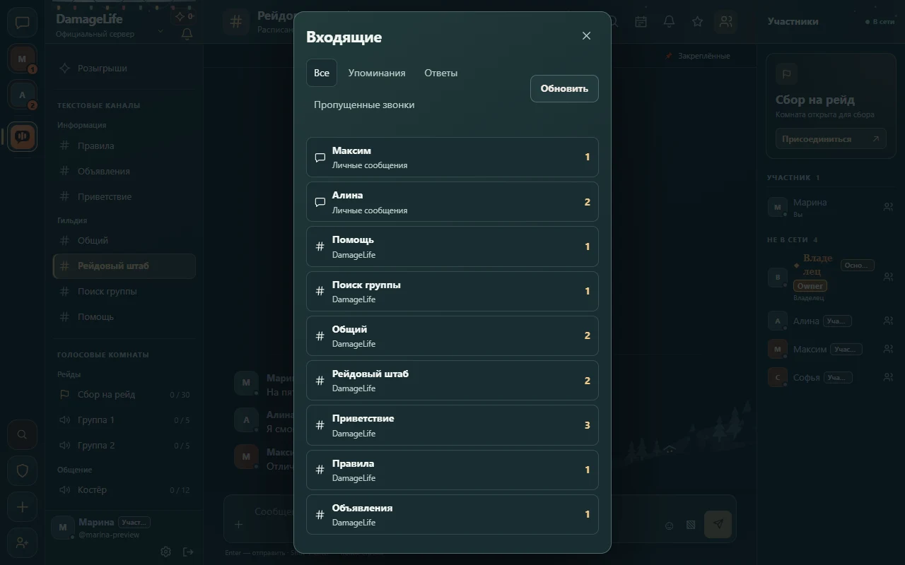
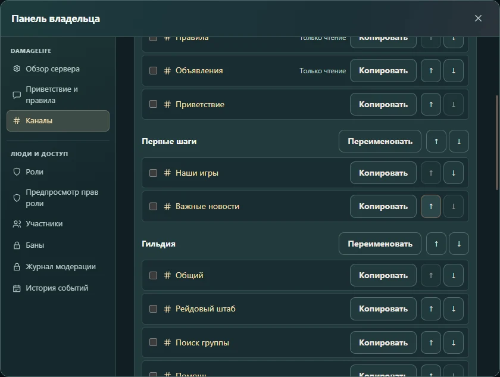
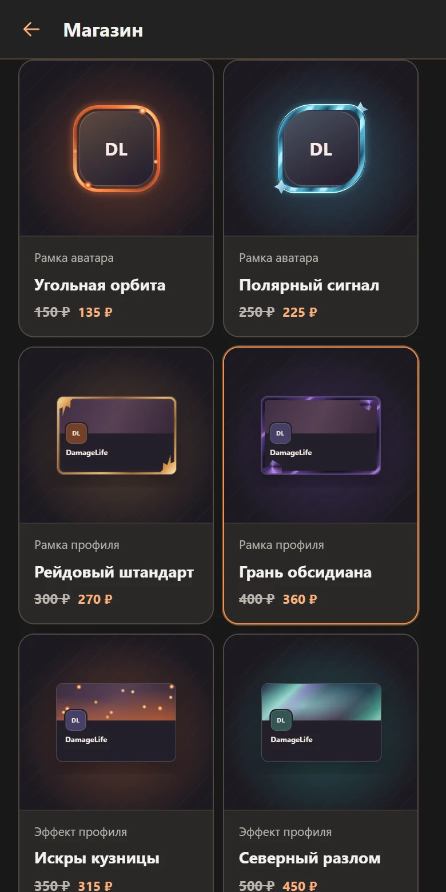

  

<h1 align="center">DLMessenger</h1>

  <strong>Чаты, голос и свои серверы для гильдии и друзей.</strong> 
  Проект вырос из голосовых сборов DamageLife. Теперь здесь можно собрать своё сообщество, созвониться с другом, показать экран или послушать музыку вместе.

  <strong><a href="https://damagelife.ru/dlmessenger/app/">Открыть в браузере</a></strong> ·
  <a href="#загрузка">Скачать приложение</a> ·
  <a href="https://damagelife.ru/dlmessenger/#preview">Посмотреть галерею</a>

## Загрузка

| Платформа | Как открыть DLMessenger |
| :-- | :-- |
| **Windows 10/11 · x64** | [Скачать DLMessenger на Rust/Tauri](https://github.com/VegasGhoul/DLMessenger/releases/latest). Установленный клиент Tauri обновляется из приложения. |
| **Android 7.0 и новее** | [Скачать APK 4.1.2](https://github.com/VegasGhoul/DLMessenger/releases/download/mobile-4.1.2/DLMessenger-4.1.2-Android.apk) или [открыть мобильный выпуск](https://github.com/VegasGhoul/DLMessenger/releases/tag/mobile-4.1.2). |
| **iPhone, Android и компьютер** | [Веб-версия](https://damagelife.ru/dlmessenger/app/) работает в браузере. На всех устройствах используется один аккаунт. |

На Android установите новый APK поверх прежней версии. Контрольные суммы доступны в выпусках.

## В обновлении 3.0

- **Все непрочитанные под рукой.** Во входящих собраны непрочитанные сообщения, упоминания, ответы и пропущенные звонки. Новый личный диалог виден по аватару и счётчику рядом с серверами. Значок исчезает после прочтения.
- **Быстрый переход к нужному чату.** Ищите по доступным перепискам и каналам, открывайте чаты через **Ctrl+K** на ПК, обсуждайте сообщения в ветках и продолжайте черновик на другом устройстве.
- **Настройки для владельцев.** Организуйте и копируйте каналы, проверяйте доступ глазами участника с выбранной ролью и настройте стартовый экран сообщества.
- **Управление звонком.** Переносите личный звонок между устройствами и регулируйте речь, музыку и звук трансляции по отдельности.
- **Плавный каталог.** В списке украшений используются лёгкие превью. Анимация доступна при просмотре карточки.

## DLMessenger в работе

| Входящие на ПК | Настройки каналов | Каталог на телефоне |
| :--: | :--: | :--: |
|  |  |  |

[Непрочитанные в панели серверов](assets/preview-3/dm-rail-desktop.webp) · [Проверка готовности к рейду](assets/preview-3/raid-desktop.webp)

## Возможности

| Раздел | Что доступно |
| :-- | :-- |
| **Переписка** | Друзья, личные чаты и каналы. Изображения, стикеры, реакции, закрепления, сохранённые сообщения и настройки уведомлений. |
| **Голос и видео** | Голосовые комнаты, личные звонки, камера, режим рации, демонстрация окна или экрана с ПК и полноэкранный просмотр. |
| **DLMusic** | Поиск по названию и исполнителю или ссылке на отдельный трек Spotify. Звук берётся из доступного источника, а очередь общая для комнаты. |
| **Сообщества** | Серверы по приглашениям, категории, права ролей, правила, модерация и журнал событий. В календаре рейдов есть запись, резерв, проверка готовности и временные голосовые группы. |
| **Оформление** | Аватары, темы и украшения профиля. На ПК есть новогодняя тема со снегом, гирляндами и Гринчем. |

### DamageLife Boost

Переписка, звонки, демонстрация, поиск и ветки доступны бесплатно. Подписки расширяют возможности оформления и лимиты.

| Возможность | Базовый | Boost | Boost Plus |
| :-- | --: | --: | --: |
| Обычные серверы | 10 | 20 | 20 |
| Сохранённые сообщения | 20 | 100 | 250 |
| Папки для сохранённых сообщений | — | 5 | 20 |
| Дополнительные шаблоны сервера | — | 2 | 5 |
| История событий своего сервера | 7 дней | 7 дней | 180 дней |

Boost включает анимированные изображения профиля, стиль имени и готовые оформления. В Plus можно хранить до пяти собственных вариантов оформления профиля. Подписку можно оформить себе или подарить. [Актуальные тарифы на сайте](https://damagelife.ru/dlmessenger/#boost)

## Обратная связь

Чтобы начать, откройте DLMessenger, войдите или зарегистрируйтесь. Официальный сервер DamageLife добавится автоматически. Для других серверов понадобится приглашение.

Если столкнулись с ошибкой, воспользуйтесь поддержкой в приложении или [сообщите о проблеме на GitHub](https://github.com/VegasGhoul/DLMessenger/issues/new/choose). Укажите платформу, версию и шаги воспроизведения. [Все выпуски](https://github.com/VegasGhoul/DLMessenger/releases)
